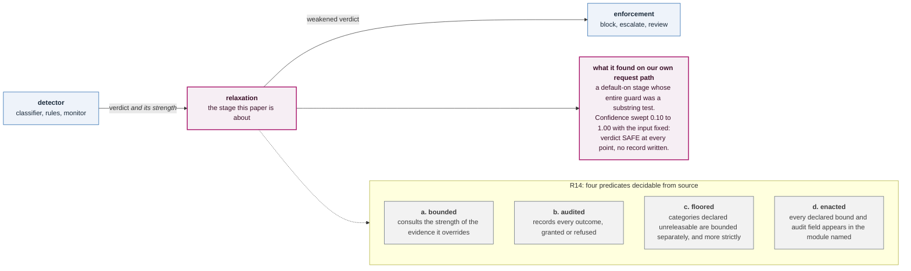
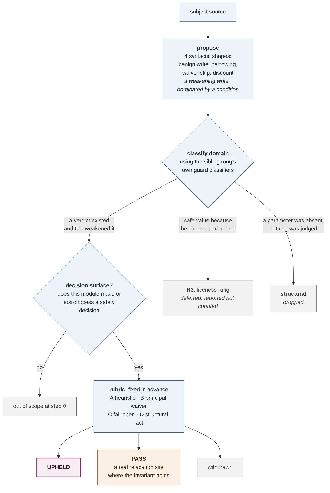
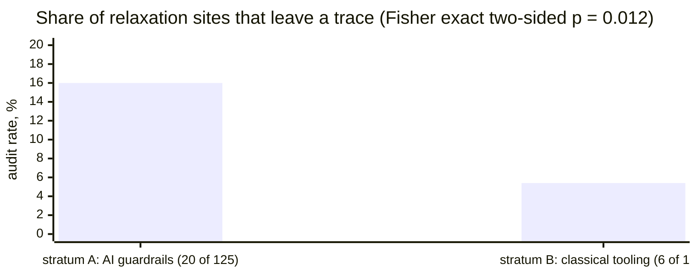
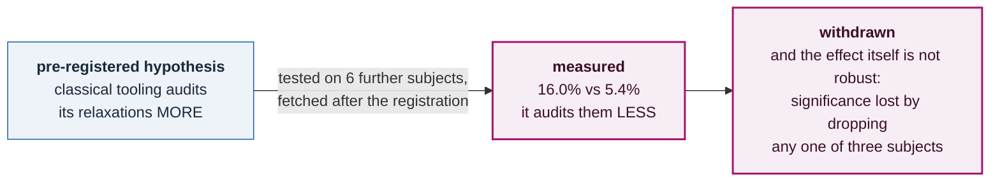

# Paper 14 figures, in Mermaid

The paper compiles to PDF, so its four figures are TikZ
(`backend/paper/bounded_relaxation.tex`). Mermaid does not render inside LaTeX.

These are the same four figures in Mermaid, for slides, README pages, issue
threads and artifact pages, where TikZ does not render either.

**Edit them together.** A figure that says one thing in the paper and another in
a deck is the drift this project keeps building checkers against. Every number
below traces to the same artifacts the paper does:

| number | artifact |
|---|---|
| 470 / 237 / 72 / 161 / 136 / 3 / 8 | `external_r14_results.json` + `adjudication.json`, via `summarize.py` |
| 811 / 509 / 195 / 2 / 2 | `external_r14_ts_results.json` + `adjudication_ts.json`, via `summarize_ts.py` |
| 125 / 20 / 16.0% / 112 / 6 / 5.4% / p = 0.012 | `audit_rate.json`, via `audit_rate.py` |

---

## Figure 1 — the relaxation stage and the four obligations

Paper: `fig:stage`.

---

## Figure 2 — from source to verdict

Paper: `fig:pipeline`. The proposer judges nothing about safety; the rubric was
fixed before any external result was read.

---

## Figure 3 — the funnel, in each language

Paper: `fig:funnel`. The last two stages are small because they are meant to be.

```mermaid
---
config:
  xyChart:
    width: 900
    height: 420
---
xychart-beta
    title "Proposals to verdicts. Blue: 28 Python subjects. Orange: 11 TypeScript subjects."
    x-axis ["proposed", "in R14 domain", "on a decision surface", "a real relaxation site", "violates the invariant"]
    y-axis "sites" 0 --> 850
    bar [470, 237, 136, 11, 3]
    bar [811, 509, 195, 4, 2]
```

Same data as a table, because a bar chart cannot show a 3 next to an 811:

| stage | Python (28 subjects) | TypeScript (11 subjects) |
|---|---:|---:|
| proposed by the scanner | 470 | 811 |
| in this rung's domain | 237 | 509 |
| deferred to the liveness rung | 72 | 91 |
| structural, dropped | 161 | 211 |
| on a decision surface | 136 | 195 |
| a real relaxation site (upheld + pass) | 11 | 4 |
| **violates the invariant (upheld)** | **3** | **2** |
| site precision | 8.1% | 2.1% |
| violation precision | 2.2% | 1.0% |

---

## Figure 4 — the pre-registered population test, falsified

Paper: `fig:auditrate`. The hypothesis was that stratum B would audit its
relaxations **more**. It audits them **less**, by 10.6 points, and the
difference does not survive dropping any one of three subjects
(`garak`, `mypy`, `pylint`).

